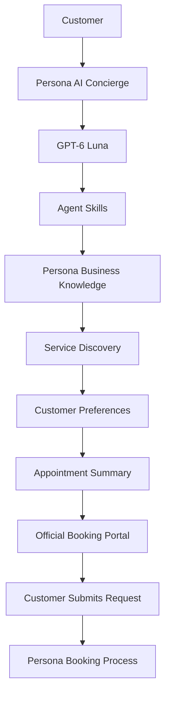

# 🤖 Persona AI Concierge — Bilingual AI Salon Assistant

## 🌐 Live Demo

**[Try Persona AI Concierge](https://lowb4k5vhfca.run.agentplace.io/)**

A bilingual (Bangla & English) AI-powered customer service and appointment-assistance agent built using Agentplace and GPT-6 Luna for Persona, a beauty and salon business in Bangladesh.

---

## 📌 Project Overview

Persona AI Concierge is a customer-facing AI agent designed to improve how customers interact with Persona's beauty and salon services.

The agent helps customers explore available services, understand the service menu, communicate their preferences, and navigate the appointment-request process through Persona's official booking portal.

It supports both Bangla and English, providing an accessible conversational experience for customers.

The project demonstrates practical applications of Agentic AI, conversational AI design, prompt engineering, knowledge integration, workflow design, vibe coding, testing, and deployment.

---

## 🎯 Problem Statement

Customers looking for salon and beauty services often need assistance with:

- Exploring available services.
- Understanding different service categories.
- Finding the appropriate service options.
- Communicating their appointment preferences.
- Navigating the appointment-request process.

Traditional information channels may require customers to search through multiple pages or contact the business directly for basic assistance.

Persona AI Concierge addresses these challenges through a conversational AI interface that provides structured service information and guides customers towards the official appointment portal.

---

## 🎯 Project Objectives

- Build a practical AI-powered customer service agent for a real business.
- Provide bilingual customer interaction in Bangla and English.
- Organize and integrate verified business service information.
- Help customers explore and select services conversationally.
- Implement a guided appointment-preference collection workflow.
- Provide a seamless handoff to the official booking portal.
- Ensure responsible AI responses by avoiding unsupported information.
- Publish a publicly accessible customer-facing AI agent.

---

## ✨ Key Features

### 1. Bilingual Conversational AI
- Supports Bangla and English.
- Responds according to the customer's language.
- Provides natural conversational assistance.
- Maintains a friendly and professional communication style.

### 2. Business Knowledge Integration

Integrates Persona's owner-supplied service menus across four categories, covering 20 listed services.

**Facial Services**
- Bright Nourishing Facial
- Oxy CollagenA
- Persona Special Facial
- Detoxify Brightening Facial
- Hydro Transformation Facial

**Hair Treatments**
- Hot Oil Massage
- Absolute Hair Care
- Protein
- Hair Spa
- Heena

**Top Haircuts**
- Front Layer (U)
- Long Layer
- Blunt Cut
- Persona Special Layer
- Butterfly

**Makeup Services**
- Special Party Makeover
- Bridal Makeover By Kaniz Almas Khan
- Gorgeous Makeover
- Hair Do
- Mehendi

### 3. Intelligent Service Discovery
- Helps customers explore the available service categories.
- Presents verified service names.
- Supports conversational service selection.
- Avoids inventing treatment details or benefits.

### 4. Guided Appointment Assistance

Provides a structured conversational booking-assistance workflow.

The agent can:
- Identify the customer's selected service.
- Ask for their preferred outlet.
- Collect their preferred appointment date.
- Collect their preferred appointment time.
- Summarize the customer's preferences.
- Direct customers to Persona's official appointment portal.

### 5. Official Booking Portal Integration (Customer-Led Handoff)

Directs customers to Persona's official appointment portal:

https://appointment.persona.com.bd/

Customers enter their own contact information and submit their appointment requests through the official portal.

### 6. Responsible AI Behaviour
- Does not invent service prices.
- Does not assume treatment ingredients or benefits.
- Does not fabricate outlet information.
- Does not claim to verify appointment availability.
- Does not claim to submit or confirm appointments.
- Clearly distinguishes customer preferences from confirmed bookings.

---

## 🛠 Technologies & Tools Used

| Technology / Tool | Application |
|---|---|
| Agentplace | AI agent development and deployment platform |
| GPT-6 Luna | Customer-facing AI model |
| Agentic AI | Conversational agent capabilities |
| Prompt Engineering | Agent instructions and behavioural design |
| Knowledge Integration | Business service information |
| UI Interaction | Customer-facing conversational interface |
| MCP | Built-in UI interaction capability |
| Bangla & English | Bilingual conversational experience |
| Vibe Coding | AI-assisted development workflow |

---

## 🏗️ Agent Architecture

The project follows a conversational AI architecture in which the customer interacts with a deployed AI agent.



The agent uses its configured customer-facing model, business knowledge and conversational instructions to guide customers through the service-discovery and appointment-assistance journey.

---

## 🔄 Customer Conversation Workflow

The customer journey follows these stages:

1. **Customer Interaction:** Customer opens the public AI assistant.
2. **Language Detection:** Agent communicates in Bangla or English.
3. **Service Discovery:** Customer explores available service categories.
4. **Service Selection:** Customer selects a preferred service.
5. **Preference Collection:** Agent asks about preferred outlet, date and time.
6. **Preference Summary:** Agent summarizes the customer's stated preferences.
7. **Booking Handoff:** Agent provides the official appointment portal.
8. **Customer Submission:** Customer enters their contact information and submits the appointment request through Persona's portal.

---

## 🧪 Testing & Validation

The agent was tested through both Bangla and English conversations.

**Testing areas included:**

| Test Category | Validation |
|---|---|
| Language Support | Bangla and English conversations |
| Service Discovery | All four service categories |
| Service Accuracy | All 20 supplied service names |
| Appointment Guidance | Guided preference collection |
| Outlet Handling | Unknown outlet handled without invention |
| Date & Time | Recorded as customer preferences |
| Booking Handoff | Official Persona portal |
| Responsible Responses | No invented prices or availability |
| Booking Confirmation | No false confirmation claims |
| Public Deployment | Verified through an incognito browser |

The published agent was also tested independently to verify public accessibility and basic chat functionality.

---

## 🚧 Current Limitations

The current implementation provides conversational booking assistance rather than fully automated appointment booking.

- No direct connection to Persona's booking database.
- No live appointment availability checking.
- No automated appointment submission.
- No booking-status verification.
- No connected external CRM or calendar integration.
- Service pricing and detailed treatment information are not available in the verified knowledge base.

These capabilities would require authorized access to Persona's booking system and appropriate external integrations.

---

## 🚀 Future Improvements

Potential future enhancements include:

- Integration with an authorized booking API.
- Live appointment availability checking.
- Automated booking-request submission.
- CRM integration for customer management.
- Calendar integration for appointment coordination.
- Automated booking-status notifications.
- Expanded verified business knowledge.
- More comprehensive conversational testing.

---

## 📁 Repository Structure

```text
persona-ai-concierge/
│
├── README.md
│
├── docs/
│   ├── project-overview.md
│   ├── agent-architecture.md
│   ├── conversation-workflow.md
│   └── testing-and-validation.md
│
├── screenshots/
│   ├── agentplace-builder/
│   ├── customer-interface/
│   ├── bangla-tests/
│   ├── english-tests/
│   └── booking-journey/
│
├── diagrams/
│   ├── agent-architecture.png
│   └── conversation-flow.png
│
└── assets/
    └── project-banner.png
```

---

## 👨‍💻 Author

**Md. Towfikur Rahman**

Aspiring AI Automation Engineer | AI Engineering Enthusiast

**GitHub:** https://github.com/khmtowman

**Live Project:** https://lowb4k5vhfca.run.agentplace.io/

---

⭐ If you find this project interesting, feel free to explore the live demo and the repository.
