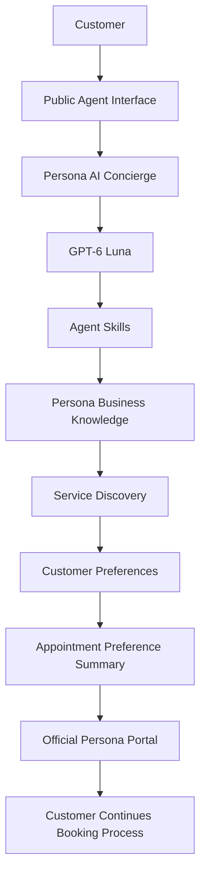
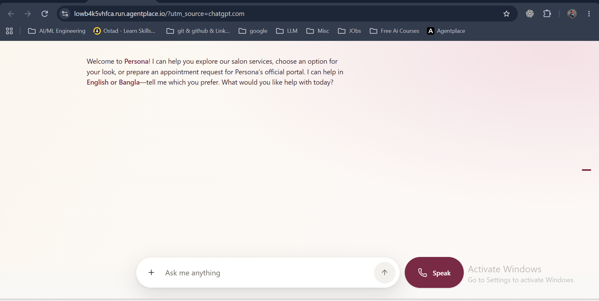
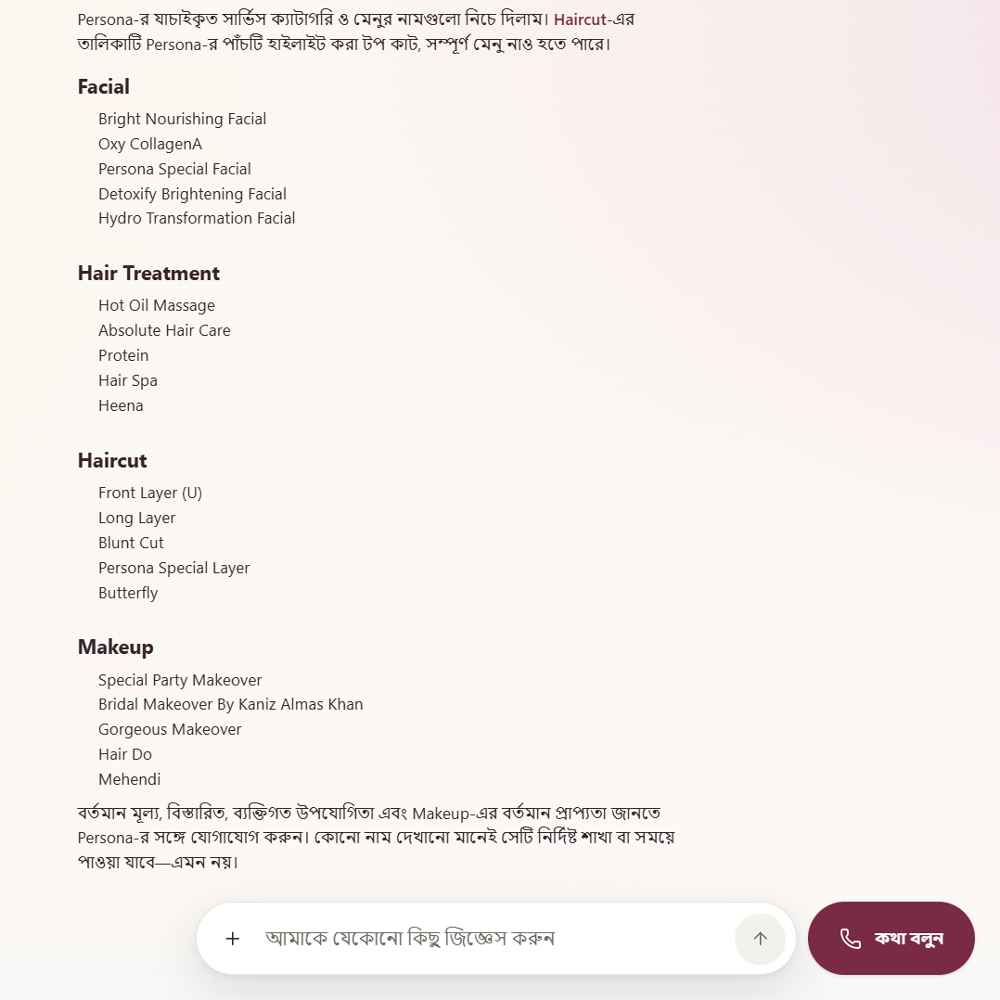
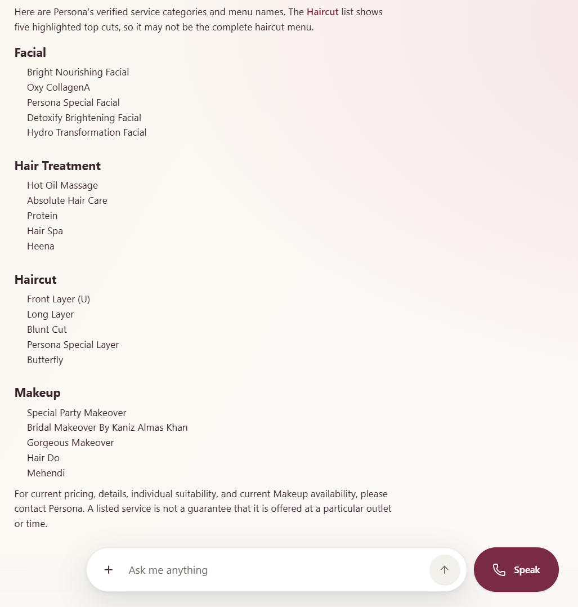
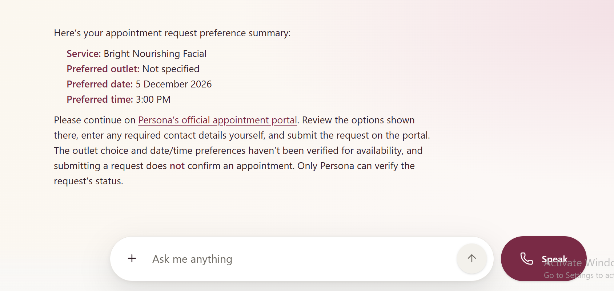

# 🤖 Persona AI Concierge — Bilingual AI Salon Assistant

<p align="center">
  <strong>A bilingual AI-powered customer service and appointment-assistance agent built for Persona, a beauty and salon business in Bangladesh.</strong>
</p>

<p align="center">
  <a href="https://lowb4k5vhfca.run.agentplace.io/">🌐 Live Demo</a> ·
  <a href="https://appointment.persona.com.bd/">Official Appointment Portal</a>
</p>

---

## 📌 Project Overview

Persona AI Concierge is a publicly deployed, customer-facing conversational AI agent designed to help customers interact with Persona's beauty and salon services.

Built using Agentplace and GPT-6 Luna, the assistant communicates in **Bangla and English**, helps customers explore available services, guides them through appointment preferences, and directs them to the official appointment portal.

The project demonstrates practical applications of:

- Agentic AI and conversational AI
- Prompt engineering and behavioral design
- Business knowledge integration
- AI-assisted development and vibe coding
- Conversational workflow design
- Manual testing and validation
- Public AI agent deployment

## 🎯 Problem Statement

Customers looking for salon and beauty services may need help with:

- Exploring available services.
- Understanding service categories.
- Selecting suitable service options.
- Communicating appointment preferences.
- Navigating the appointment-request process.

Persona AI Concierge addresses these needs through a bilingual conversational interface that makes service discovery and appointment assistance more accessible.

## 🎯 Project Objectives

- Build a practical AI-powered customer service assistant.
- Support natural conversations in Bangla and English.
- Integrate verified, owner-supplied business service information.
- Enable conversational service discovery and selection.
- Design a guided appointment-preference workflow.
- Provide a handoff to the official appointment portal.
- Reduce unsupported AI-generated business information.
- Deploy a publicly accessible customer-facing agent.

## ✨ Key Features

### 1. Bilingual Conversational AI

- Supports Bangla and English.
- Responds according to the customer's language.
- Provides natural conversational assistance.
- Maintains a friendly and professional communication style.

### 2. Business Knowledge Integration

The agent uses owner-supplied service information covering 20 services across four categories.

**Facial Services**
- Bright Nourishing Facial
- Oxy CollagenA
- Persona Special Facial
- Detoxify Brightening Facial
- Hydro Transformation Facial

**Hair Treatments**
- Hot Oil Massage
- Absolute Hair Care
- Protein
- Hair Spa
- Heena

**Top Haircuts**
- Front Layer (U)
- Long Layer
- Blunt Cut
- Persona Special Layer
- Butterfly

**Makeup Services**
- Special Party Makeover
- Bridal Makeover By Kaniz Almas Khan
- Gorgeous Makeover
- Hair Do
- Mehendi

### 3. Conversational Service Discovery

- Introduces the available service categories.
- Presents the supplied service names.
- Helps customers select a specific service.
- Avoids inventing unsupported treatment details or benefits.

### 4. Guided Appointment Assistance

The agent guides customers through a structured conversation.

It can:

- Identify the selected service.
- Ask for a preferred outlet.
- Collect a preferred appointment date.
- Collect a preferred appointment time.
- Summarize the customer's preferences.
- Direct customers to the official appointment portal.

### 5. Official Appointment Portal Handoff

The agent directs customers to Persona's official appointment portal:

**https://appointment.persona.com.bd/**

Customers continue the appointment process independently on the portal and enter their own contact information.

**Important:** This is a customer-led handoff, not a direct booking-system integration. The agent does not verify live availability, submit appointments, or retrieve booking confirmations.

### 6. Responsible AI Behavior

The agent is designed to:

- Avoid inventing service prices.
- Avoid unsupported treatment ingredients or benefits.
- Avoid fabricating outlet information.
- Avoid claiming real-time appointment availability.
- Avoid claiming successful appointment submission.
- Distinguish customer preferences from confirmed bookings.

---

## 🛠 Technologies & Tools Used

| Technology / Tool | Application |
|---|---|
| Agentplace | AI agent development and deployment |
| GPT-6 Luna | Customer-facing AI model |
| Agentic AI | Conversational agent capabilities |
| Prompt Engineering | Instructions and behavioral design |
| Knowledge Integration | Persona's supplied business information |
| Agent Skills | Salon-specific knowledge and UI interaction capabilities |
| MCP / UI Interaction | Built-in customer-interface interaction capability |
| Bangla & English | Bilingual conversational experience |
| Vibe Coding | AI-assisted development workflow |
| GitHub | Version control and project documentation |

*The built-in UI interaction capability is not an external integration with Persona's booking database or CRM.*

## 🏗️ Agent Architecture

The project uses a conversational AI architecture connecting the customer-facing interface, configured language model, agent skills, and business knowledge.



The agent handles conversational assistance and preference collection. The official appointment portal is an external customer-facing destination; no direct booking API connection is implemented.

For further details, see [Agent Architecture](docs/agent-architecture.md).

## 🔄 Customer Conversation Workflow

The customer journey follows these stages:

1. **Customer Interaction:** Customer opens the public AI assistant.
2. **Language Selection:** Agent communicates in Bangla or English.
3. **Service Discovery:** Customer explores available categories.
4. **Service Selection:** Customer chooses a preferred service.
5. **Preference Collection:** Agent asks about outlet, date, and time.
6. **Preference Summary:** Agent summarizes the customer's stated preferences.
7. **Portal Handoff:** Agent provides the official appointment portal.
8. **Customer Action:** Customer continues the process independently on the portal.

See [Conversation Workflow](docs/conversation-workflow.md) for the detailed workflow and an example conversation.

## 🧪 Testing & Validation

The agent underwent manual functional testing through its published customer-facing interface.

| Testing Area | Validation |
|---|---|
| Language Support | Bangla and English conversations |
| Service Discovery | Four service categories |
| Service Knowledge | 20 supplied service names |
| Service Selection | Conversational selection |
| Appointment Guidance | Preference collection workflow |
| Outlet Handling | Unknown outlet handled without invention |
| Date & Time | Acknowledged as customer preferences |
| Booking Handoff | Official Persona portal |
| Responsible Responses | No unsupported prices or availability claims |
| Public Deployment | Access verified through an incognito browser |

The testing was manual. Automated unit testing, performance testing, security penetration testing, and actual appointment submission were not performed.

See [Testing & Validation](docs/testing-and-validation.md) for the test cases, observations, and limitations.

## 🚧 Current Limitations

The current implementation provides conversational appointment assistance rather than fully automated booking.

- No direct connection to Persona's booking database.
- No live appointment availability checking.
- No automated appointment submission.
- No booking-status verification.
- No external CRM or calendar integration.
- No verified service pricing or detailed treatment information in the available knowledge base.

These capabilities would require authorized business-system access and appropriate integrations.

## 🚀 Future Improvements

Potential enhancements include:

- Authorized booking API integration.
- Real-time outlet and appointment availability lookup.
- Automated appointment-request submission.
- CRM integration for customer management.
- Calendar integration for appointment coordination.
- Booking-status retrieval and notifications.
- Expanded verified business knowledge.
- Automated conversational regression testing.
- More comprehensive security and performance testing.

These are proposed enhancements, not currently implemented features.

## 📸 Screenshots & Demo Preview

Explore the customer-facing interface and key interaction stages of Persona AI Concierge.

### Welcome Screen



### Bilingual Service Discovery

**Bangla Service Menu**



**English Service Menu**



### Appointment Assistance

The agent collects customer preferences, summarizes the requested service, outlet, date, and time, and provides a handoff to the official appointment portal.



[View All Customer Interface Screenshots](screenshots/customer-interface/README.md)

## 📚 Project Documentation

| Document | Description |
|---|---|
| [Project Overview](docs/project-overview.md) | Business context, problem, objectives, and project scope |
| [Agent Architecture](docs/agent-architecture.md) | Architecture, components, and integration boundaries |
| [Conversation Workflow](docs/conversation-workflow.md) | Customer journey and appointment-assistance workflow |
| [Testing & Validation](docs/testing-and-validation.md) | Manual test cases, observed results, and limitations |

## 📁 Repository Structure

```text

persona-ai-concierge/
│
├── README.md
│
├── docs/
│   ├── project-overview.md
│   ├── agent-architecture.md
│   ├── conversation-workflow.md
│   └── testing-and-validation.md
│
└── screenshots/
    └── customer-interface/
        ├── README.md
        ├── welcome-screen.png
        ├── bangla-service-menu.png
        ├── english-service-menu.png
        └── final-summary.png

```

Additional screenshots, diagrams, and visual assets may be added as the portfolio documentation evolves.

## 👨‍💻 Author

**Md. Towfikur Rahman**

Aspiring AI Automation Engineer | AI Engineering Enthusiast

- **GitHub:** https://github.com/khmtowman
- **Live Project:** https://lowb4k5vhfca.run.agentplace.io/

---

⭐ Explore the live demo and project documentation to see how conversational AI can support real-world customer service workflows.
