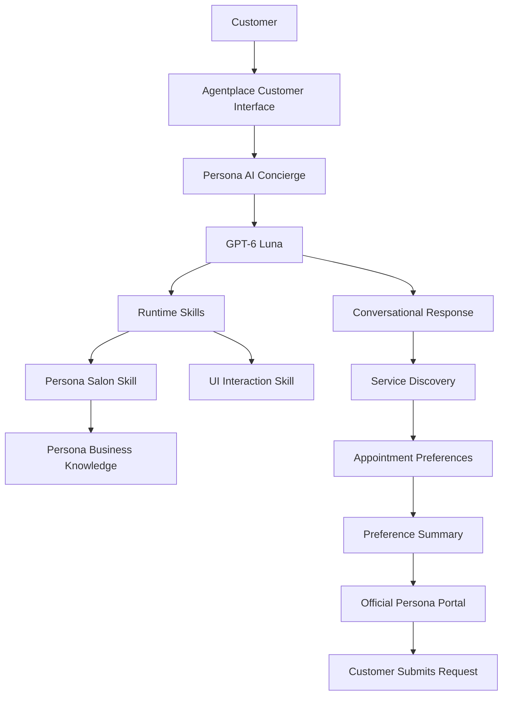

# Agent Architecture — Persona AI Concierge

## 1. Architecture Overview

Persona AI Concierge uses a conversational AI architecture built on Agentplace.

The customer-facing agent is configured to use GPT-6 Luna through the OpenAI provider route.

Its architecture combines:

- A customer-facing conversational interface.
- An AI language model.
- Runtime agent skills.
- Business-specific knowledge and instructions.
- UI interaction capabilities.
- An external appointment-portal handoff.

The architecture is designed to support service discovery, bilingual communication and guided appointment assistance.

## 2. Core Architecture Components

### 2.1 Customer Interface

The customer interacts with the agent through its publicly deployed Agentplace interface.

The interface supports:
- Text-based conversations.
- Bangla and English interaction.
- Conversational service discovery.
- Guided appointment-preference collection.

The project also has realtime voice capability enabled in its configuration.

### 2.2 AI Model

**Configured model:** GPT-6 Luna

**Provider route:** OpenAI

**Reasoning effort:** Low

**Processing tier:** Fast

The model powers the customer-facing conversational experience, following the agent's instructions and available business knowledge.

### 2.3 Runtime Skills

The project has two configured runtime skills:

**Persona Salon (`persona-salon`)**

Provides business-specific knowledge and instructions, including:
- Persona's service categories.
- Owner-supplied service names.
- Customer-service guidance.
- Appointment-portal information.
- Responsible-response rules.

**UI Interaction (`ui-interaction`)**

Provides the agent's built-in UI interaction capability.

This is a built-in interface capability, not an external Persona business-system integration.

### 2.4 Business Knowledge

The agent uses supplied Persona business information covering four service categories:

1. Facial Services
2. Hair Treatments
3. Top Haircuts
4. Makeup Services

The knowledge includes 20 supplied service names.

The agent is instructed to avoid unsupported claims about pricing, ingredients, benefits, treatment suitability, availability and results.

### 2.5 External Booking Portal

The agent provides a customer-led handoff to Persona's official appointment portal:

https://appointment.persona.com.bd/

The customer completes the contact-information and appointment-request process through the portal.

There is currently no direct API, webhook or external booking-system connection configured.

## 3. High-Level Architecture Diagram

## 4. Customer Request Processing

The general interaction flow consists of the following stages:

### Stage 1 — Customer Input

A customer sends a message through the public agent interface.

### Stage 2 — AI Processing

The configured customer-facing model processes the conversation using the available agent instructions and business knowledge.

### Stage 3 — Business Knowledge Retrieval and Application

The agent uses the Persona-specific knowledge and service information to formulate an appropriate response.

### Stage 4 — Conversational Assistance

The agent responds in the customer's language and helps with service discovery or appointment preferences.

### Stage 5 — Preference Collection

When a customer wants appointment assistance, the agent gathers:
- Selected service.
- Preferred outlet, if known.
- Preferred appointment date.
- Preferred appointment time.

### Stage 6 — Booking Handoff

The agent summarizes the preferences and provides the official appointment portal.

### Stage 7 — Customer Submission

The customer independently enters their contact details and submits the appointment request through Persona's portal.

## 5. Integration Architecture

### Existing Capabilities

| Component | Status |
|---|---|
| Agentplace customer interface | Configured |
| GPT-6 Luna | Configured |
| Persona Salon runtime skill | Configured |
| UI Interaction runtime skill | Configured |
| Business service knowledge | Configured |
| Official booking-portal handoff | Configured |
| Bangla and English support | Configured |

### External Integrations Not Yet Implemented

| Integration | Status |
|---|---|
| Persona booking API | Not connected |
| External CRM | Not connected |
| Google Calendar | Not connected |
| Microsoft Bookings | Not connected |
| Automated booking notifications | Not configured |
| Booking-status verification | Not implemented |

## 6. Responsible Architecture and Limitations

The architecture deliberately separates conversational assistance from actual booking operations.

The AI agent can collect customer preferences and provide booking guidance, but it cannot independently verify available appointment slots or create confirmed appointments.

This separation helps prevent:
- False booking confirmations.
- Invented appointment availability.
- Unsupported business information.
- Misleading customer expectations.

Any future automated booking capability must use an authorized integration with Persona's actual booking system.

## 7. Future Architecture Enhancements

Potential architectural improvements include:

- Authorized booking API integration.
- Live service and outlet information.
- Real-time appointment availability.
- Secure booking-request submission.
- CRM connectivity.
- Appointment-status retrieval.
- Event-driven customer notifications.
- Expanded business knowledge management.

## 8. Technology Summary

| Layer | Technology |
|---|---|
| Agent Development | Agentplace |
| Customer-facing AI | GPT-6 Luna |
| AI Provider Route | OpenAI |
| Agent Skills | Persona Salon, UI Interaction |
| Knowledge | Persona business service information |
| Interaction | Conversational UI |
| Languages | Bangla and English |
| Booking Handoff | Persona official appointment portal |

---

**Project:** Persona AI Concierge  
**Architecture Type:** Conversational AI Agent  
**Development Approach:** AI-assisted development / Vibe Coding  
**Deployment Platform:** Agentplace  
**Live Demo:** https://lowb4k5vhfca.run.agentplace.io/
