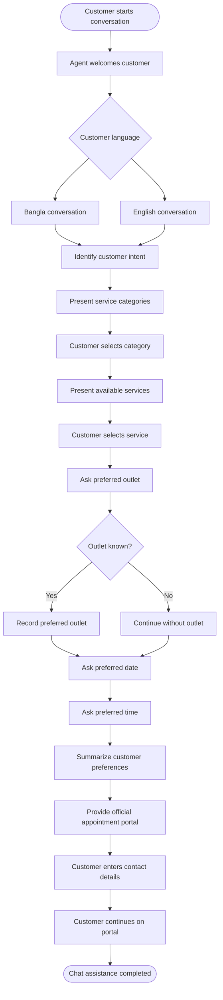

# Customer Conversation Workflow

## 1. Purpose

This document explains how Persona AI Concierge interacts with customers, guides them through salon service selection, collects appointment preferences, and directs them to the official Persona appointment portal.

The workflow is designed to make the customer experience simple, conversational, bilingual, and transparent.

**Important:** The agent assists with appointment preferences. It does not directly create, submit, or confirm appointments.

## 2. Conversation Principles

The agent follows these principles:

- **Bilingual communication:** Supports Bangla and English and responds according to the customer's language.
- **One question at a time:** Collects information through a natural conversational sequence.
- **Customer-led selection:** Lets customers choose their preferred service and share their preferences.
- **No invented information:** Does not fabricate prices, availability, service durations, ingredients, benefits, outlet details, or booking confirmations.
- **Clear communication:** Distinguishes between a customer's preferred appointment time and an actually confirmed appointment.
- **Guided handoff:** Directs customers to the official appointment portal to continue the appointment process.

## 3. End-to-End Customer Journey

The conversation follows these stages:

### Stage 1: Greeting and Understanding Intent

The agent welcomes the customer and identifies what they need help with.

A customer may ask about salon services, request recommendations, or express an intention to book an appointment.

### Stage 2: Service Category Selection

The agent introduces the available service categories:

1. Facial
2. Hair Treatments
3. Top Haircuts
4. Makeup

### Stage 3: Specific Service Selection

After the customer chooses a category, the agent presents the corresponding services.

The knowledge base contains 20 services across four categories.

The customer can select a service or ask questions about the listed options.

### Stage 4: Preferred Outlet

The agent asks which Persona outlet the customer prefers.

If the customer does not know their preferred outlet, the agent accepts that response and continues without inventing outlet names or locations.

### Stage 5: Preferred Appointment Date

The agent asks the customer for their preferred date.

The date is treated as a customer preference, not evidence of appointment availability.

### Stage 6: Preferred Appointment Time

The agent asks for the customer's preferred time.

Again, this is recorded conversationally as a preference and is not treated as a confirmed time slot.

### Stage 7: Preference Summary

The agent summarizes the information provided:

- Selected service
- Preferred outlet, if provided
- Preferred date
- Preferred time

The customer can review the summary before proceeding.

### Stage 8: Official Appointment Portal Handoff

The agent directs the customer to the official Persona appointment portal:

https://appointment.persona.com.bd/

The customer continues the process independently on the portal.

The portal's initial form requests:

- Full Name
- Phone Number
- E-Mail

The customer enters their information and proceeds using the portal's Next button.

The agent does not collect these contact details inside the chat.

## 4. Workflow Diagram

*This diagram represents the logical customer journey. It does not indicate a live booking-system integration.*

## 5. Example Conversation: Bangla

The following example illustrates the guided appointment-preference workflow.

**Customer:** আমি ব্রাইডাল মেকআপ করতে চাই।

**Agent:** অবশ্যই! আমাদের Makeup ক্যাটাগরিতে কয়েকটি সার্ভিস রয়েছে। এর মধ্যে Bridal Makeover By Kaniz Almas Khan রয়েছে। আপনি কি এই সার্ভিসটি নিতে চান?

**Customer:** হ্যাঁ।

**Agent:** চমৎকার! আপনি কোন Persona আউটলেট পছন্দ করবেন?

**Customer:** জানি না।

**Agent:** কোনো সমস্যা নেই। তাহলে আপাতত আউটলেট নির্দিষ্ট না করেই এগোই। আপনি কোন তারিখে অ্যাপয়েন্টমেন্ট নিতে চান?

**Customer:** ২৫ নভেম্বর ২০২৬।

**Agent:** ধন্যবাদ! আপনি ২৫ নভেম্বর ২০২৬ তারিখটি পছন্দ করেছেন। এবার কোন সময়ে যেতে চান?

**Customer:** ৪টা।

**Agent:** আপনার পছন্দগুলো হলো:

- Service: Bridal Makeover By Kaniz Almas Khan
- Preferred outlet: Not specified
- Preferred date: 25 November 2026
- Preferred time: 4:00 PM

এগুলো আপনার পছন্দের তথ্য, নিশ্চিত অ্যাপয়েন্টমেন্ট নয়।

অ্যাপয়েন্টমেন্টের পরবর্তী ধাপ সম্পন্ন করতে অনুগ্রহ করে Persona-এর অফিসিয়াল পোর্টালে যান:

https://appointment.persona.com.bd/

সেখানে আপনার প্রয়োজনীয় তথ্য দিয়ে পরবর্তী ধাপ অনুসরণ করুন।

## 6. Booking Handoff and System Boundaries

The current implementation uses a customer-led handoff rather than a direct booking integration.

### What the agent currently does

- Guides customers through service selection.
- Asks for preferred outlet, date, and time.
- Summarizes the customer's preferences.
- Provides the official appointment portal link.
- Explains that the customer must continue the process on the portal.

### What the agent does not currently do

- Access live appointment availability.
- Verify available time slots.
- Create or submit an appointment.
- Connect to Persona's booking database or CRM.
- Send appointment requests through an API or webhook.
- Receive booking confirmation or status updates.
- Guarantee that a preferred date or time is available.

**The distinction matters:** Sharing appointment preferences in a conversation is not the same as submitting or confirming a booking.

## 7. Edge Cases and Responsible Responses

| Situation | Expected behavior |
|---|---|
| Customer does not know the preferred outlet | Accept the response and continue |
| Customer has not decided on a date | Ask when they would prefer to visit |
| Customer has not decided on a time | Allow them to provide a preference later |
| Customer asks for an unknown price | Avoid inventing a price |
| Customer asks about unavailable service details | Avoid unsupported claims |
| Customer asks whether a time is confirmed | Explain that availability has not been verified |
| Customer expects the agent to complete the booking | Explain the portal handoff process |

## 8. Customer Data and Privacy

The conversation is designed to minimize the collection of personal information.

- The agent does not need the customer's phone number, email address, or full name to guide service selection.
- Customers enter their contact information directly on the official appointment portal.
- Customers should not share passwords, payment credentials, or unnecessary sensitive information in the chat.

## 9. Current Scope and Future Improvements

The current workflow provides conversational appointment assistance and a link to the official booking portal.

Possible future enhancements include:

- Official booking API integration.
- Live outlet and service availability lookup.
- Real-time appointment slot verification.
- Automated appointment request submission.
- Booking confirmation and status retrieval.
- CRM integration and customer follow-up automation.

These enhancements would require appropriate access, authorization, and integration support from Persona.

## 10. Project Links

- **Live AI Agent:** https://lowb4k5vhfca.run.agentplace.io/
- **Official Appointment Portal:** https://appointment.persona.com.bd/
- **GitHub Repository:** https://github.com/khmtowman/persona-ai-concierge

---

*Documentation note: This document describes the implemented conversational workflow and distinguishes existing capabilities from proposed future integrations.*
