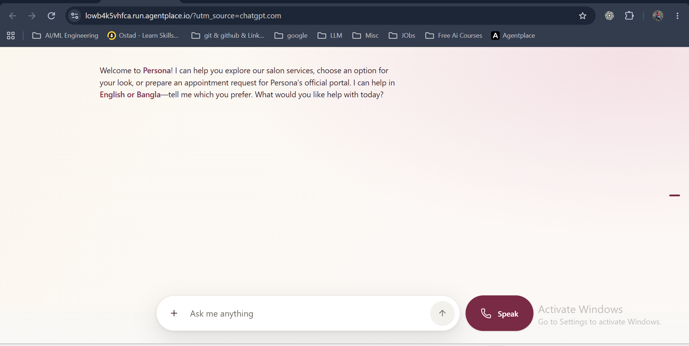
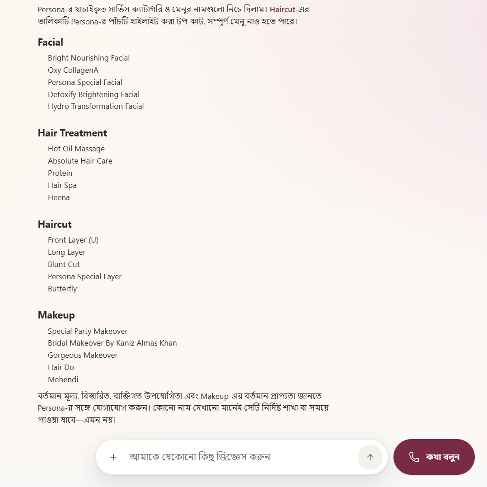
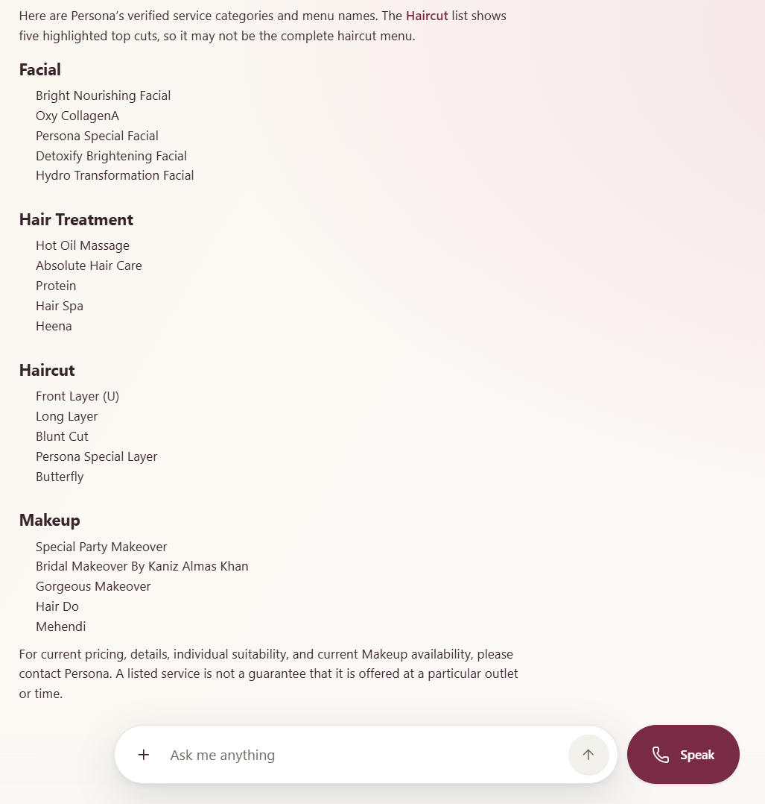
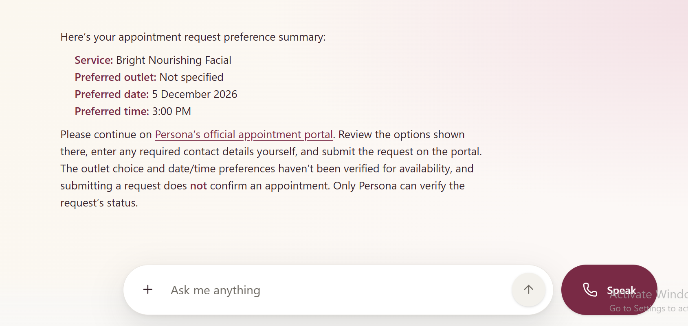

# Customer Interface Screenshots

This folder contains visual evidence of the publicly deployed Persona AI Concierge, demonstrating its bilingual customer interface, service discovery, and guided appointment-assistance workflow.

## 1. Welcome Screen

The initial customer-facing interface of the AI assistant.

## 2. Bangla Service Menu

Demonstrates service discovery in Bangla across the four available categories.

## 3. English Service Menu

Demonstrates service discovery in English across the four available categories.

## 4. Appointment Preference Summary

Shows the completed conversational preference-collection workflow and handoff to Persona's official appointment portal. The preferences are not a confirmed booking.

